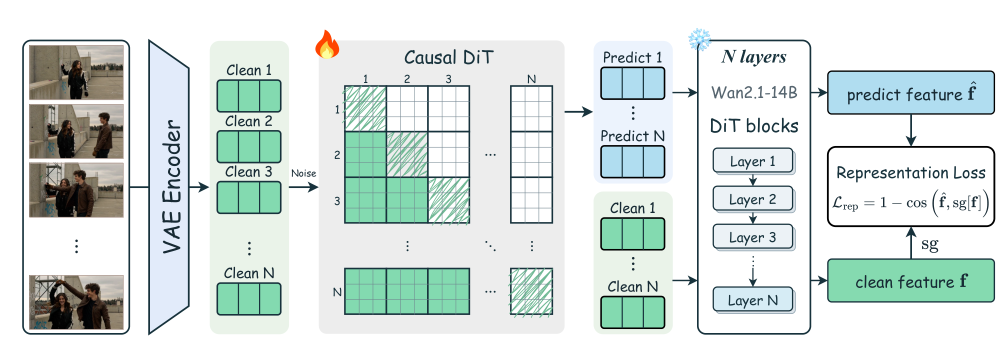

<div align="center">

# RepForcing
### Representation-Space Initialization for Autoregressive Video Distillation

Representation-space initialization and four-step autoregressive video distillation

<p>
  <a href="#overview">Overview</a> ·
  <a href="#results">Results</a> ·
  <a href="#quick-start">Quick Start</a> ·
  <a href="#inference">Inference</a> ·
  <a href="#training">Training</a> ·
  <a href="#evaluation">Evaluation</a>
</p>

</div>

---

**Representation Forcing (RepForcing)** trains a causal generator in the representation space of a frozen video DiT. A single teacher-forcing initialization stage replaces intermediate AR teacher training and causal ODE distillation, followed by **asymmetric DMD**. Initialization reuses existing synthetic videos without generating additional causal ODE trajectories.

The paper reports that, after DMD, the **four-step chunk-wise** model improves VBench Total from **84.04 to 84.66** and VisionReward from **6.326 to 10.074** over Causal Forcing. Both **frame-wise** and **chunk-wise** configurations are provided. See [Results](#results) for evaluation conditions and the full metric breakdown.

<p align="center">
  
  <br />
  <em>Example video frames from the paper.</em>
</p>

## Table of Contents

- [Overview](#overview)
  - [Paper Settings and Current Implementation](#implementation-notes)
- [Results](#results)
- [Quick Start](#quick-start)
  - [Installation](#installation)
  - [Base Models and Checkpoints](#checkpoints)
- [Inference](#inference)
- [Training](#training)
  - [Stage 1: RFT Initialization](#stage-1)
  - [Stage 2: Asymmetric DMD](#stage-2)
  - [Logging and Distributed Execution](#logging)
- [Evaluation and Tests](#evaluation)
- [Acknowledgements and License](#acknowledgements)

<a id="overview"></a>
## Overview

RepForcing consists of two training stages:

1. **RFT: representation-supervised initialization.** The causal student predicts video latents conditioned on clean history. Predictions and clean targets pass through the same frozen Wan2.1-14B DiT, and their token features are compared using **cosine loss**. Target features are detached; gradients through the frozen extractor update the student. No additional latent MSE or adversarial loss is used.
2. **Asymmetric DMD.** The RFT checkpoint initializes the generator for four-step autoregressive rollouts conditioned on its own generated history. A Wan2.1-14B teacher and a Wan2.1-1.3B auxiliary score model provide distribution-matching supervision. The RFT feature extractor is not used in this stage.

**RFT** stands for **RepForcing Train** and names Stage 1 in the code. Stage 2 uses the `dmd` namespace. Both stages share the [`train.py`](train.py) entry point.

<p align="center">
  
  <br />
  <em>Stage-1 training from the paper. The frozen extractor measures representation differences between predictions and targets.</em>
</p>

### Available Configurations

| Setting | RFT initialization | Four-step DMD | Latent frames per block |
| :--- | :--- | :--- | ---: |
| Frame-wise | `rft.framewise` | `dmd.framewise` | 1 |
| Chunk-wise | `rft.chunkwise` | `dmd.chunkwise` | 3 |

DMD uses the configured timestep list `[1000, 750, 500, 250]`, with timestep warping applied as configured. DMD initialization and inference require checkpoints matching the frame-wise or chunk-wise setting.

<a id="implementation-notes"></a>
<details>
<summary><strong>Paper settings and current implementation: check before reproducing results</strong></summary>

The commands below describe the current code. Both RFT configurations use feature-extractor timestep `0`. The following differences from the paper remain:

| Setting | Paper | Current code |
| :--- | :--- | :--- |
| Feature-extractor attention | Native bidirectional attention | Causal attention |
| Feature extraction block | Block 8, one-based | `perceptual_layer=8`, a zero-based Python index corresponding to block 9 |

See [`configs/rft.py`](configs/rft.py) and [`model/diffusion_rft.py`](model/diffusion_rft.py). Current defaults should not be treated as identical to the paper's experimental settings, and the reported scores below are not a claim of end-to-end reproduction with this code snapshot.

</details>

<a id="results"></a>
## Results

The following numbers are taken from the paper's main comparison table. Both RepForcing settings use **four-step generation after DMD**, evaluated on **81-frame, 832 × 480** videos.

### Chunk-wise

| Method | VBench Total ↑ | Quality ↑ | Semantic ↑ | Dynamic Degree ↑ | VisionReward ↑ | Instruction Following ↑ |
| :--- | ---: | ---: | ---: | ---: | ---: | ---: |
| CausVid | 81.33 | 83.98 | 70.72 | 62 | 5.741 | 12 |
| Self Forcing | 83.74 | 84.48 | 80.77 | 57 | 5.820 | 48 |
| Causal Forcing | 84.04 | 84.59 | **81.84** | 68 | 6.326 | 56 |
| Causal-rCM | 84.37 | 85.02 | 81.73 | **71** | 8.211 | 64 |
| **RepForcing** | **84.66** | **85.55** | 81.10 | 69 | **10.074** | **78** |

### Frame-wise

| Method | VBench Total ↑ | Quality ↑ | Semantic ↑ | Dynamic Degree ↑ | VisionReward ↑ | Instruction Following ↑ |
| :--- | ---: | ---: | ---: | ---: | ---: | ---: |
| Causal Forcing | 83.75 | 84.35 | **81.37** | 64 | 6.204 | 42 |
| Causal Forcing++ | 84.10 | 84.94 | 80.75 | 71 | 6.798 | 47 |
| **RepForcing** | **84.38** | **85.67** | 79.21 | **78** | **10.598** | **80** |

**Evaluation protocol:**

- VBench Total, Quality, and Semantic use standard VBench prompts. The separate Dynamic Degree, VisionReward, and Instruction Following evaluations use Causal Forcing's 100-prompt motion set, with scores multiplied by 100 as in the paper.
- Instruction Following measures prompt alignment using VisionReward; it is not human-study accuracy. VisionReward values are not accuracy percentages either.
- Most baseline scores follow the Causal Forcing report. Frame-wise Causal Forcing++ scores come from its report, and Causal-rCM scores come from pretrained-weight evaluations. This is **not a controlled retraining comparison under a common training budget**.
- Bold marks the highest value in each column within a group. RepForcing does not lead every metric. These reported results do not establish that this repository has reproduced them end to end.

<a id="quick-start"></a>
## Quick Start

This repository provides training, inference, and evaluation code. Base models, RepForcing checkpoints, and training data are not included. Run the commands below from the **project root**; launchers under `scripts/` switch to that directory automatically.

<a id="installation"></a>
### Installation

Use **Python ≥ 3.10** and an NVIDIA CUDA GPU. A separate environment is recommended:

```bash
conda create -n repforcing python=3.10 -y
conda activate repforcing
```

Install a PyTorch / torchvision pair compatible with your CUDA driver before installing the project dependencies. Causal attention uses `torch.nn.attention.flex_attention`; the dependency list requires **PyTorch ≥ 2.5 and torchvision ≥ 0.20**.

```bash
python -m pip install -r requirements.txt
python -m pip install flash-attn --no-build-isolation
python -m pip install -e . --no-deps
```

FlashAttention must match the PyTorch, CUDA, and GPU architecture combination. Keep evaluation dependencies separate, particularly VisionReward's older Transformers requirement. See the [evaluation environment instructions](vbench/README.md).

<a id="checkpoints"></a>
### Base Models and Checkpoints

Download the base models from the official [Wan2.1](https://github.com/Wan-Video/Wan2.1) model repositories:

```bash
hf download Wan-AI/Wan2.1-T2V-1.3B --local-dir wan_models/Wan2.1-T2V-1.3B
hf download Wan-AI/Wan2.1-T2V-14B --local-dir wan_models/Wan2.1-T2V-14B
```

Keep the complete model configurations and weights. The 1.3B directory also supplies the text encoder, tokenizer, and VAE:

```text
wan_models/
├── Wan2.1-T2V-1.3B/
│   ├── config.json
│   ├── models_t5_umt5-xxl-enc-bf16.pth
│   ├── Wan2.1_VAE.pth
│   └── google/umt5-xxl/
└── Wan2.1-T2V-14B/
    └── config.json
```

DiT weight shards are omitted from this tree. Follow the base models' terms of use and do not add model directories to Git.

**Base Wan weights are not RepForcing checkpoints.** No RepForcing weight download links are provided here; train or otherwise prepare matching checkpoints before inference. The paths below are examples and may be replaced with actual training outputs:

| Configuration | Example checkpoint path | Usage |
| :--- | :--- | :--- |
| `rft.framewise` | `checkpoints/stage1_framewise.pt` | RFT multi-step inference and frame-wise DMD initialization |
| `rft.chunkwise` | `checkpoints/stage1_chunkwise.pt` | RFT multi-step inference and chunk-wise DMD initialization |
| `dmd.framewise` | `checkpoints/dmd_framewise.pt` | Four-step frame-wise inference |
| `dmd.chunkwise` | `checkpoints/dmd_chunkwise.pt` | Four-step chunk-wise inference |

<a id="inference"></a>
## Inference

### Four-step T2V

**Frame-wise:**

```bash
sh scripts/run_inference.sh \
  --config dmd.framewise \
  --checkpoint_path checkpoints/dmd_framewise.pt \
  --data_path prompts/demos.txt \
  --output_folder output/framewise \
  --use_ema
```

**Chunk-wise:**

```bash
sh scripts/run_inference.sh \
  --config dmd.chunkwise \
  --checkpoint_path checkpoints/dmd_chunkwise.pt \
  --data_path prompts/demos.txt \
  --output_folder output/chunkwise \
  --use_ema
```

`--use_ema` requires a `generator_ema` entry in the checkpoint. Early DMD checkpoints may contain only `generator`; omit the flag in that case. `prompts/demos.txt` contains 100 example prompts, not a training dataset.

<details>
<summary><strong>Inspect Stage-1 RFT initialization with multi-step inference</strong></summary>

```bash
sh scripts/run_inference.sh \
  --config rft.framewise \
  --checkpoint_path checkpoints/stage1_framewise.pt \
  --data_path prompts/demos.txt \
  --output_folder output/stage1_framewise
```

For chunk-wise inference, use `rft.chunkwise` and `checkpoints/stage1_chunkwise.pt`.

The RFT example does not use `--use_ema`. The CLI defaults to multi-step UniPC, while training-time visualization defaults to CPS. These are different sampling settings, and the default CLI run should not be equated with the paper's four-step initialization comparison.

</details>

Output filenames use the first 100 characters of each prompt. Avoid duplicate prefixes and path separators in custom prompts. Use different output directories for different models or sampling configurations.

<a id="training"></a>
## Training

List the registered configurations:

```bash
sh scripts/train.sh --list
```

Both stages are dispatched by `train.py` using `config.trainer`. The launcher uses torchrun. `GPUS_PER_NODE=8` below is an example, not a verified minimum GPU count or memory requirement. The default global batch size is 64; gradient accumulation is derived from the actual world size and per-device batch size.

<a id="stage-1"></a>
### Stage 1: RFT Initialization

<details>
<summary><strong>Data preparation and training commands</strong></summary>

The paper uses videos synthesized by a bidirectional model as clean targets instead of generating additional causal ODE trajectories. Here, clean refers to unnoised training latents, not necessarily real-world footage.

Training reads a **clean-latent LMDB**, defaulting to `dataset/clean_data`. Neither the dataset nor a complete raw-video collection, filtering, and VAE encoding pipeline is included. [`LatentLMDBDataset`](utils/dataset.py) expects:

| Key | Content |
| :--- | :--- |
| `latents_shape` | Space-separated dataset shape, e.g. `N 1 21 16 60 104` |
| `latents_{i}_data` | Contiguous float16 bytes for a sample shaped `[S, F, C, H, W]` or `[F, C, H, W]` |
| `prompts_{i}_data` | UTF-8 prompt text |
| `prompts_shape` | Sample count `N`; required by the merge tool |

The dataset selects the last latent along S as the clean target. Defaults use 21 latent frames, 16 channels, and a spatial size of 60×104.

To extract clean latents and merge existing shards in this format:

```bash
python utils/merge_and_get_clean.py \
  --sources dataset/shard_0 dataset/shard_1 \
  --output dataset/clean_data
```

Inputs are read-only and are not deleted. The output directory must be absent or empty. Do not read LMDB shards while another process is writing them.

**Frame-wise:**

```bash
GPUS_PER_NODE=8 sh scripts/train.sh rft.framewise \
  --data_path dataset/clean_data
```

**Chunk-wise:**

```bash
GPUS_PER_NODE=8 sh scripts/train.sh rft.chunkwise \
  --data_path dataset/clean_data
```

These commands launch separate jobs. RFT uses `trainer: rft`. Its optional `--generator_ckpt` initializes generator weights; it does not restore the full training state.

Checkpoints are saved to:

```text
<logdir>/run_<timestamp>/checkpoint_model_<step>/model.pt
```

Select the checkpoint matching your frame-wise or chunk-wise setting for Stage 2.

</details>

<a id="stage-2"></a>
### Stage 2: Asymmetric DMD

<details>
<summary><strong>Prompts, initialization checkpoints, and training commands</strong></summary>

Prepare `dataset/train_prompts.txt` as UTF-8 text with one nonempty prompt per line. `prompts/demos.txt` is for demonstrations and the corresponding evaluation protocol, not a training dataset specification.

Stage 2 requires a Stage-1 generator checkpoint. Point directly to its training output or organize checkpoints under the example paths below.

**Frame-wise:**

```bash
GPUS_PER_NODE=8 sh scripts/train.sh dmd.framewise \
  --data_path dataset/train_prompts.txt \
  --generator_ckpt checkpoints/stage1_framewise.pt
```

**Chunk-wise:**

```bash
GPUS_PER_NODE=8 sh scripts/train.sh dmd.chunkwise \
  --data_path dataset/train_prompts.txt \
  --generator_ckpt checkpoints/stage1_chunkwise.pt
```

Use matching frame-wise or chunk-wise initialization weights. `--generator_ckpt` initializes the generator only; it does not restore optimizer state or the complete training state.

DMD updates the critic every outer step and, by default, the generator once every five outer steps. Checkpoints are saved to:

```text
<logdir>/checkpoint_model_<step>/model.pt
```

Use DMD checkpoints for four-step inference. The presence of `generator_ema` depends on the EMA state when the checkpoint was saved.

</details>

**Both stages train continuously without an automatic step limit.** Checkpoints are saved every `log_iters` steps. Stopping a job does not trigger an additional save; confirm that the checkpoint you need has been written before stopping. `--no_save` and `--no_visualize` disable checkpoint saving and training-time visualization, respectively.

<a id="logging"></a>
### Logging and Distributed Execution

- Shell launchers default to `logs/rft_framewise`, `logs/rft_chunkwise`, `logs/dmd_framewise`, or `logs/dmd_chunkwise`. Override with `LOGDIR` or `--logdir`.
- When the Python entry point is used directly without `--logdir`, RFT defaults to `logs/stage1` and DMD to `logs/dmd`.
- Configure multiple nodes using `NNODES`, `NODE_RANK`, `MASTER_ADDR`, and `MASTER_PORT` supplied by your environment.
- Use `--config_path` for a complete YAML configuration instead of `--config`, not alongside it. RFT YAML configurations use `trainer: rft`.
- The resolved configuration is written to `<logdir>/runtime_config.yaml` for run records and evaluation.

**W&B is disabled by default.** To enable it, provide `WANDB_API_KEY`, `WANDB_ENTITY`, and `WANDB_PROJECT` through the environment and pass `--enable-wandb`. Set `WANDB_MODE=offline` for offline runs. Do not place credentials in configuration files.

Unless specified, `--wandb-save-dir` uses the resolved log directory. Configuration exports filter authentication fields but still contain local model, data, and log paths; inspect them before sharing.

<a id="evaluation"></a>
## Evaluation and Tests

See **[VBench, Dynamic Degree, and VisionReward](vbench/README.md)** for evaluation commands and dependencies. Standard VBench and the separate 100-prompt evaluations have different input naming and aggregation protocols; do not mix them.

<details>
<summary><strong>CPU tests without model weights</strong></summary>

```bash
PYTHONDONTWRITEBYTECODE=1 python -B -m unittest discover -s tests -v
PYTHONDONTWRITEBYTECODE=1 python -B vbench/scripts/test_score_vision_reward.py
```

Tests cover configurations, entry points, training control, synthetic LMDB conversion, and scoring protocols. GPU models are mocked and test data is created in temporary directories. These tests do not validate model quality, full GPU evaluation, or hardware compatibility in a new environment.

</details>

<a id="acknowledgements"></a>
## Acknowledgements and License

This implementation builds on the following open-source projects:

- [Causal Forcing / Causal Forcing++](https://github.com/thu-ml/Causal-Forcing): causal video training, asymmetric DMD, and inference implementations.
- [Self Forcing](https://github.com/guandeh17/Self-Forcing) and [CausVid](https://github.com/tianweiy/CausVid): autoregressive video distillation components.
- [Wan2.1](https://github.com/Wan-Video/Wan2.1): video DiT, text encoder, VAE, and base models.
- [FramePack](https://github.com/lllyasviel/FramePack): inference memory-management utilities.
- [VBench](https://github.com/Vchitect/VBench) and [VisionReward](https://github.com/zai-org/VisionReward): evaluation tools and scoring resources.

The code retains the [Apache-2.0](LICENSE) license. See [NOTICE.md](NOTICE.md) for provenance, copyright, and source-release notes. Base models, training data, evaluation models, and external dependencies have their own terms of use.
